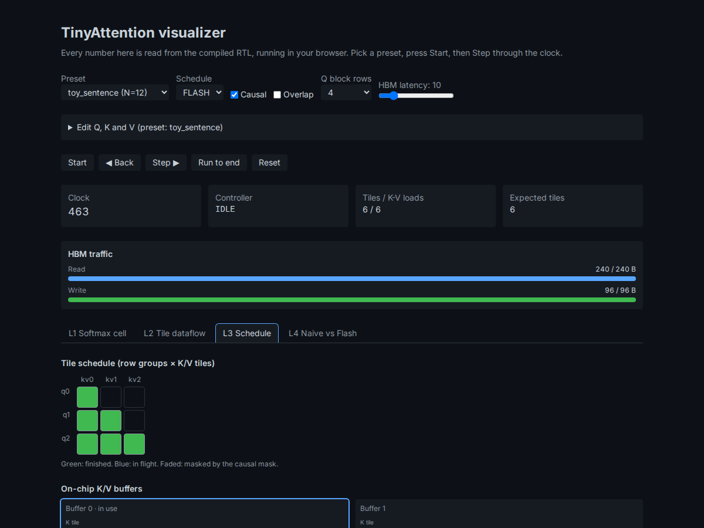

# TinyAttention

A synthesizable **FlashAttention engine** in SystemVerilog, verified bit-exact against a golden model, compiled to
WebAssembly, and running live in your browser.

**Live:** https://tiny-attention.vercel.app



Fourth project in the series after [tiny-gpu](https://github.com/deaneeth/tiny-gpu),
[tiny-tpu](https://github.com/deaneeth/tiny-tpu) and tiny-cpu. Same rule as the others: nothing on screen is faked.
Every value comes from a debug port on the compiled RTL, or from the golden model the RTL is checked against.

## What it does

Attention computes `softmax(Q Kᵀ / √d) V`. The score matrix is N × N, and storing it is what makes standard attention
expensive in memory. FlashAttention computes the output one tile at a time with an online softmax, so the matrix never
exists in memory. This engine implements that schedule, plus the standard three-pass schedule for comparison, with
optional overlap of the K/V loads with compute.

## Verification

| What | Result |
|---|---|
| Engine vs golden model, end to end | Output, HBM bytes, tile count, K/V loads and busy cycles match on every run. Every sequence length 4 to 32, causal and not, every block size, both schedules, overlap on and off, random HBM latency, 200 seeds. |
| Exhaustive unit coverage | exp2 is checked on every input in its range; reciprocal on every mantissa. DMA burst timing is pinned cycle by cycle. |
| Output error vs float attention | Max 0.0028 to 0.0260 across the six presets (N = 12 to 16), in float units. The recorded 1000-seed study is in `sim/golden/study_results_1000seeds.txt`. |
| HBM traffic at N = 32 | Non-causal: FLASH 2432 B (4-row blocks) or 896 B (16-row blocks), NAIVE 12672 B. Causal: FLASH 1536 B or 768 B, NAIVE 7296 B. |
| WebAssembly | The compiled module, on golden fixtures for each schedule, matches the same quantities. 83 KB gzipped. |
| Web app | Browser tests of every page, the visualizer at phone width and in both colour schemes. |
| FPGA (ECP5 LFE5U-85F) | Synthesizes with no latches: 40,416 of 83,640 LUT4 positions, 8,726 flip-flops, 51 of 156 DSP blocks, no block RAM. fmax estimate 11.5 MHz, so timing is not closed at the ULX3S 25 MHz clock. The UART interface is verified in simulation; it has not run on a board. |

Every row is a test in the repository, run by GitHub Actions on each pull request. The docs page
[Verification](https://tiny-attention.vercel.app/docs/verification) lists each check and its numbers.

## Repository

```
rtl/            SystemVerilog: arithmetic blocks, tile core, memory, controllers, top level
sim/            cocotb unit and end-to-end tests, the golden model (sim/golden), lint and run scripts
wasm/           Verilator + Emscripten build, the C++ harness, and the Node test over golden fixtures
web/            Astro + React site: the visualizer at /app, the docs, and the Vitest and Playwright tests
docs/           Architecture, the plan, the state schema, and the media for this README
```

## Quick start

```bash
bash .tools/setup.sh && bash .tools/emsdk.sh      # Verilator 5.036 + Emscripten (project-local)
python3 -m venv .venv && .venv/bin/pip install -r sim/requirements.txt
source scripts/env.sh

bash sim/lint.sh                                   # Verilator -Wall on every module
bash sim/run_unit.sh                               # cocotb unit suites
SEEDS=200 bash sim/run_e2e.sh                      # engine vs golden, end to end
pytest sim/golden -q                               # golden model, fixtures, generated tables

bash wasm/build.sh && node wasm/test.mjs           # WebAssembly engine + golden fixtures

cd web && pnpm install && pnpm dev                 # the site (dev server; see note below)
pnpm build && pnpm test:e2e                        # production build and browser tests
```

Note: `astro dev` hangs without output in some environments. `pnpm build` followed by any static file server over
`web/dist` works.

## Docs

Six pages with live demos: [what attention computes](https://tiny-attention.vercel.app/docs/what-is-attention),
[the online softmax](https://tiny-attention.vercel.app/docs/online-softmax),
[the FlashAttention schedule](https://tiny-attention.vercel.app/docs/flashattention),
[fixed-point formats and error](https://tiny-attention.vercel.app/docs/fixed-point),
[the architecture](https://tiny-attention.vercel.app/docs/architecture), and
[verification](https://tiny-attention.vercel.app/docs/verification).

The plan and the status of each phase are in [`docs/PLAN.md`](docs/PLAN.md). The architecture, with the measured
schedule and traffic models, is in [`docs/ARCHITECTURE.md`](docs/ARCHITECTURE.md).

## License

MIT
